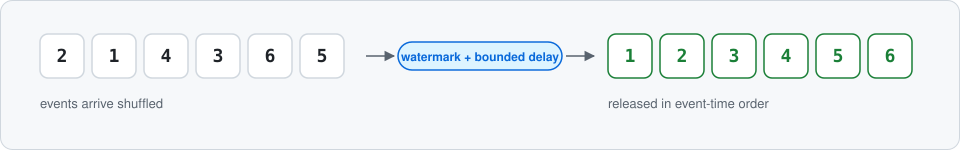
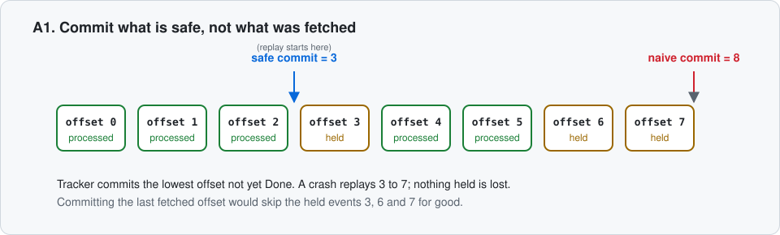
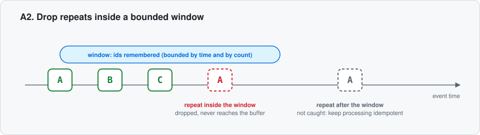
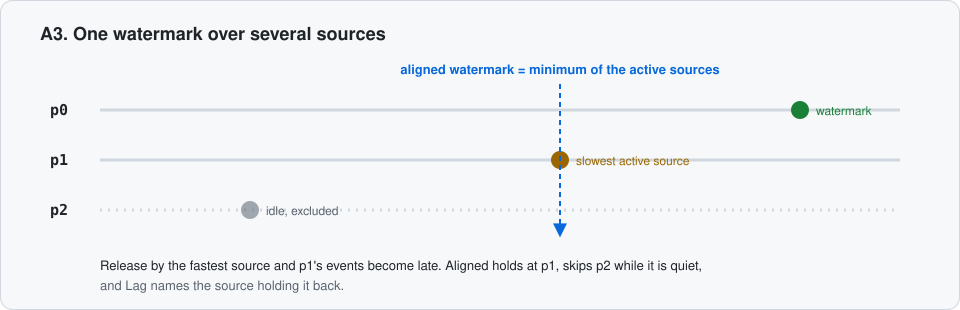
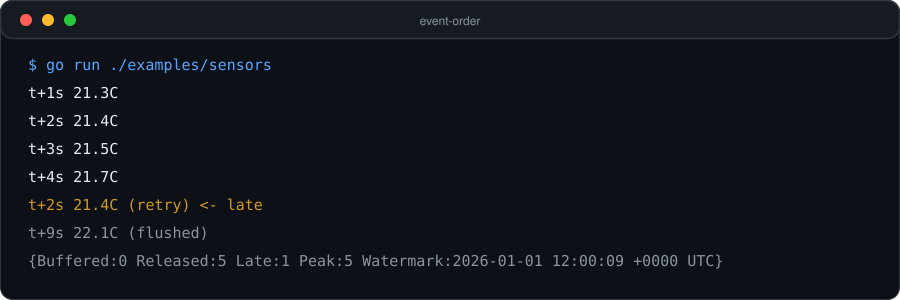
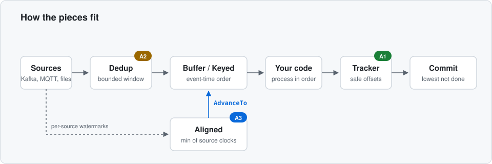
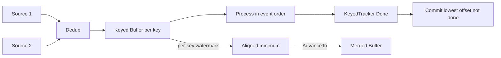
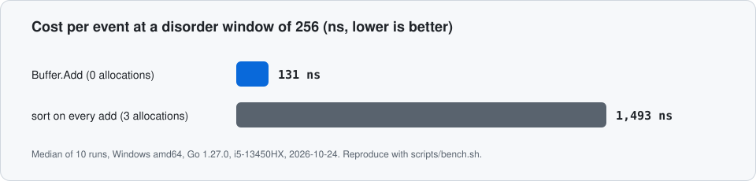

<p align="center"></p>

<h1 align="center">event-order</h1>

<p align="center">
Event-time ordering, safe commit offsets, duplicate windows and aligned watermarks for Go streams.<br>
Zero dependencies, bounded memory, one import: no cluster to run.
</p>

<p align="center">
<a href="#the-three-gaps">The gaps</a> |
<a href="#try-it">Try it</a> |
<a href="#at-a-glance">At a glance</a> |
<a href="#why-not-containerheap-or-flink">Why not heap or Flink</a> |
<a href="#engineering-quality-and-proof">Proof</a> |
<a href="#status-and-roadmap">Roadmap</a>
</p>

<p align="center">
<a href="https://github.com/A-RYAN-1/event-order/actions/workflows/ci.yml"></a>
<a href="https://codecov.io/gh/A-RYAN-1/event-order"></a>
<a href="https://www.bestpractices.dev/projects/16022"></a>
<a href="https://pkg.go.dev/github.com/A-RYAN-1/event-order"></a>


</p>

<p align="center">
<picture>
<source media="(prefers-color-scheme: dark)" srcset="docs/assets/hero-dark.svg">

</picture>
</p>

<p align="center"><sub>Status: v0.x, the API may change between minor versions. Last updated: 2026-10-28. Public, no release tagged yet.</sub></p>

---

## Contents

- [About](#about)
- [The three gaps](#the-three-gaps)
- [Try it](#try-it)
- [At a glance](#at-a-glance)
- [Features](#features)
- [Why it exists](#why-it-exists)
- [How it works](#how-it-works)
- [Kafka, MQTT and Watermill](#kafka-mqtt-and-watermill)
- [Why not container/heap or Flink](#why-not-containerheap-or-flink)
- [Engineering quality and proof](#engineering-quality-and-proof)
- [Limits](#limits)
- [Related work](#related-work)
- [Command line](#command-line)
- [Run it locally](#run-it-locally)
- [Environment variables](#environment-variables)
- [Deployment](#deployment)
- [Status and roadmap](#status-and-roadmap)
- [Contributing](#contributing)
- [License](#license)
- [Credits](#credits)

## About

Brokers, retrying producers, sensors and mobile clients deliver events late, shuffled and sometimes twice. Code that
trusts arrival order computes the wrong thing: a reading applied before an older one, a total counted twice, an offset
committed past events that were never processed.

`event-order` is the in-process answer. Add events as they arrive and get back the ones that are now safe to process,
sorted by event time. Around that core it solves three problems that sorting alone leaves open, each tested against a
reference model that shares no code with it.

## The three gaps

Sorting events is the easy part. These are the parts that are easy to get wrong, and what this library does about each.

### A1. Offsets you can commit while events are held

<p align="center">
<picture>
<source media="(prefers-color-scheme: dark)" srcset="docs/assets/a1-commit-dark.svg">

</picture>
</p>

 A consumer that holds events to reorder them cannot commit the
offset of the last message it fetched, because a crash then loses everything still held.

```go
// Before: commit what was fetched. A crash loses every held event.
b.Add(msg.Time, msg)
commit(msg.Partition, msg.Offset+1)

// After: commit only up to the lowest event not yet processed.
for _, r := range s.Ingest(msg.Partition, msg.Offset, msg.Time, msg.ID, msg.Reading) {
    process(r.Value)
    s.Done(msg.Partition, r.Offset)
}
if off, ok := s.Commit(msg.Partition); ok {
    commit(msg.Partition, off)
}
```

The Kafka example simulates a crash at a random point in a shuffled three-partition stream and restarts from the
committed offsets: across 200 random crashes no reading is lost, and the consumer that commits the offset of every
fetched message loses readings in all 200.

### A2. Duplicates from at-least-once sources

<p align="center">
<picture>
<source media="(prefers-color-scheme: dark)" srcset="docs/assets/a2-dedup-dark.svg">

</picture>
</p>

 Brokers redeliver. `Dedup` drops repeated ids inside a bounded window of
event time, so memory stays near the window size instead of growing with the stream.

```go
// Before: a redelivered message is processed twice.
// After: the repeat never reaches the buffer.
d := eventorder.NewDedup[string](time.Minute, 100_000)
if !d.Seen(msg.Time, msg.ID) {
    b.Add(msg.Time, msg.Reading)
}
```

### A3. One watermark over several sources

<p align="center">
<picture>
<source media="(prefers-color-scheme: dark)" srcset="docs/assets/a3-aligned-dark.svg">

</picture>
</p>

 Release by the fastest partition's clock and the slower partitions' events
become late. `Aligned` holds the watermark at the minimum over the sources, leaves out a source that went quiet, and
`Lag` names the one holding it back.

```go
// Before: each source advances the shared buffer, so a slow source's events are dropped as late.
// After: the buffer advances only to the minimum of the source watermarks.
al := eventorder.NewAligned[string](eventorder.WithSourceIdleTimeout(30 * time.Second))
al.Register("p0")
al.Register("p1")
if wm, advanced, ok := al.Observe(src, sourceWatermark); ok && advanced {
    for _, ev := range merged.AdvanceTo(wm) {
        process(ev.Value)
    }
}
```

`Stream` joins A1 and A2 with per-key ordering in one type; `Aligned` feeds the downstream buffer that orders the merged
stream. A property test runs three partitions through both into one `Buffer` and checks global order with no late events.

## Try it

```go
b := eventorder.New[Reading](
    eventorder.WithMaxDelay(5*time.Second), // how far out of order events may arrive
    eventorder.WithMaxBuffered(10_000),     // memory bound
)
for msg := range incoming {
    for _, ev := range b.Add(msg.Time, msg.Reading) {
        process(ev.Value) // arrives sorted by event time
    }
}
for _, ev := range b.Flush() { // end of input
    process(ev.Value)
}
```

Install with `go get github.com/A-RYAN-1/event-order` (Go 1.23 or newer). The import path ends in `event-order`; the package
is `eventorder`. To see it work first, clone the repository and run `go run ./examples/sensors`. Real output, 2026-10-27:

<p align="center"></p>

Six readings arrive out of order and the retry is too late. Change `WithMaxDelay(3*time.Second)` to `10*time.Second` and
the late one is in order.

## At a glance

| You have | Use |
|---|---|
| One stream | `Buffer[T]`: `Add` returns what is ready, `AdvanceTo` moves the watermark from a timer, `Flush` empties it |
| Many streams (devices, users, partitions) | `Keyed[K, T]`: one buffer per key, `Flush(key)` and `AdvanceAll` forget finished keys |
| A channel | `Pipe`: channel in, ordered channel out, with a context and `WithIdleTimeout` for quiet sources |
| Several goroutines | `Safe`, `SafeKeyed`: the same with a mutex |
| A Kafka or MQTT consumer | `Stream`: duplicates, per-key ordering and safe commit offsets in one type |
| One watermark over several sources | `Aligned`: minimum of the source watermarks, idle sources excluded, `Lag` names the holder |
| Several ordered sources | `Merge` over `iter.Seq`; `Reorder` wraps one `iter.Seq` |
| A broker that needs commits | `Tracker`, `KeyedTracker`: the offset that is safe to commit while events are held, `Revoke` for rebalances |
| An at-least-once source | `Dedup`: drops repeated ids inside a bounded window of event time |
| A log or CSV in a shell | the `event-order` command, streaming (see [Command line](#command-line)) |

## Features

- **Event-time ordering with a bounded delay.** `Buffer` releases events once the watermark passes them, sorted.
  - The watermark is the largest event time seen minus the delay, inclusive of events at exactly that time.
  - Equal times keep arrival order; an event at or before the watermark when it arrives is late.
  - `WithMaxBuffered` caps memory: the oldest events are released early rather than the buffer growing.
  - `WithLatePolicy` either drops and counts late events (`Drop`) or emits them flagged `Late` (`Emit`); `OnLate` sees every one.
  - `WithDelayStrategy(PercentileDelay(0.99, 1024))` lets the delay follow the disorder actually seen.
- **Per-key buffers** (`Keyed`) that forget idle keys, and goroutine-safe wrappers (`Safe`, `SafeKeyed`, `Pipe`).
- **Safe commit offsets** (`Tracker`, `KeyedTracker`) with `Revoke` for rebalances.
- **Bounded duplicate window** (`Dedup`).
- **Aligned watermark** (`Aligned`) over several sources, with idle handling and a lag report.
- **Consumer glue** (`Stream`): `Ingest`, `Done`, `Commit`, `Skip`, `Revoke`, `Flush`, `AdvanceAll`, `Watermark`, `Stats`.
- **A command line** that sorts a JSON-lines log or CSV as a stream.
- **Examples as their own modules** for Kafka, MQTT and Watermill, so the library stays dependency-free.

The package guide on pkg.go.dev (`doc.go`) says how to choose a type and a delay.

## Why it exists

Ordering by event time is a solved idea in stream processors, but a Go service that reads a Kafka topic or an MQTT feed
has no small piece to do it with, and no piece at all for the commit-offset and duplicate problems that appear the moment
events are held. Building it taught that the ordering is the smallest part: the work is in the boundary cases and in
proving them against a model.

## How it works

<p align="center">
<picture>
<source media="(prefers-color-scheme: dark)" srcset="docs/assets/overview-dark.svg">

</picture>
</p>

The same flow as a diagram GitHub can inspect:



Design decisions, each with its price:

- **Hold in memory, track offsets separately.** Held events are lost on a crash, so `Tracker` keeps the commit position
  behind them and the broker replays. The price is replay after a crash, not loss.
- **Bounded everything.** The buffer has a cap, `Dedup` a window and a capacity. The price is that an extreme burst
  releases early and a very late duplicate is not caught.
- **Event time trusts the producer clock.** The library does not repair skew; use a sequence number where you control the
  producer.
- **Examples in separate modules.** A broker client never enters `go.mod`. The price is a second `go test` to run.

## Kafka, MQTT and Watermill

Each is its own Go module under `examples/`, and each takes a small interface or a channel so its tests run without a
broker. CI also runs the Kafka and MQTT tests against real brokers (Apache Kafka 3.9 and Eclipse Mosquitto 2 in Docker).

- `examples/kafka` (`segmentio/kafka-go`): per-partition ordering, `Dedup`, and commits only up to the lowest event not
  yet processed, with an idle drain so the tail of a quiet topic is not stranded.
- `examples/mqtt` (`eclipse/paho.mqtt.golang`): a subscriber that orders readings with `Pipe` and releases the tail when
  the broker goes quiet.
- `examples/watermill` (`ThreeDotsLabs/watermill`): a router handler that holds messages and publishes them in event-time
  order, plus an idle drain for the tail of a quiet topic. Limit: Watermill acknowledges a message when the handler
  returns, so a message being held is lost on a crash; where that matters use `Stream` with the broker client, as in the
  Kafka example.

Rebalances: `kafka-go` can deliver messages fetched before a rebalance after it (its issue
[1398](https://github.com/segmentio/kafka-go/issues/1398) describes it, still open when this was written). `Tracker`
cannot fix that, but it keeps your commit position correct while you handle it: flush the partition with `Keyed.Flush`,
mark the flushed events `Done`, then `KeyedTracker.Revoke`.

## Why not container/heap or Flink

**container/heap.** You can write the ordering part yourself in about forty lines, and a hand-rolled `container/heap`
loop is not slower in a way you will notice. An earlier hand-rolled loop measured within noise of this library (163 to
429 ns against 192 ns, 2026-10-24, not kept in the repo, so no current figure is claimed). `Buffer.Add` costs 105 to
131 ns per event with 0 allocations (see [Proof](#engineering-quality-and-proof)). Speed is not the reason to use this library.

The reason is the decisions around the heap that are easy to get subtly wrong: the exact lateness boundary; ties kept in
arrival order; the memory cap never exceeded; no event lost or invented; per-key buffers that forget idle keys; a quiet
source that does not hold its tail forever; a commit offset that never passes a held event; a duplicate window that
stays bounded. Each is tested here against a reference implementation. If you only need to sort a slice you already
have, use `slices.SortFunc`.

**Flink, Beam, Kafka Streams.** They solve watermarks well, with state, windows and exactly-once sinks, and they are the
right tool when you already run a cluster or a JVM stack. A Go service that only needs "these events, in the order they
happened, with a safe commit" should not need one. This library is the single watermark idea in-process, with no
checkpointing: it does not give exactly-once, and it does not replace a stream engine.

## Engineering quality and proof


<p align="center">
<picture>
<source media="(prefers-color-scheme: dark)" srcset="docs/assets/bench-dark.svg">

</picture>
</p>

Measured on Windows, amd64, Go 1.27.0, i5-13450HX: coverage and cost rows on 2026-10-27, the other rows on 2026-10-24. CI runs the same tests with `-race` on Linux, plus Windows and macOS.

| Check | Result |
|---|---|
| Statement coverage | 97.4 percent on 2026-10-27 (`go test -cover .`); CI fails under 95 percent |
| Reference-model property tests | 3,000 random operation sequences for `Buffer`, 1,000 for `Keyed`, 2,000 each for `Tracker` and `Dedup`, output identical to a sort-every-step reference, call for call |
| Crash safety | 300 random runs of `Buffer` plus `Tracker`: the commit offset never passes an unprocessed event |
| Mutation check | removing the boundary nanosecond, the arrival tie-break, the head advance of `Tracker`, the expiry bound or the cap of `Dedup` each fails tests |
| Fuzz | `FuzzKeyed` 857,827 executions, `FuzzMerge` 45,326, `FuzzTracker` 3,852,990, `FuzzDedup` 3,684,370, no failure |
| Memory | about 100 bytes per held event; `Len` never above the cap over 200,000 adds; `Dedup` holds about window-many ids |
| Cost per call | median of 10 runs, 0 allocations each: `Buffer.Add` 105 ns (jitter 16) and 131 ns (jitter 256); `Aligned.Observe` 109 ns; `Stream.Ingest` 230 ns; `Tracker` Track plus Done plus Commit 50 ns; `Dedup.Seen` 237 ns. Run-to-run spread is 1 to 5 percent for the first four rows and 31 to 75 percent for `Tracker` and `Dedup` on this laptop, so read those two as rough |
| Against sort-every-add | 131 ns against 1,493 ns at a disorder window of 256 (3 allocations per add for the baseline) |
| Kafka crash restart | 200 random crashes, no reading lost; the commit-every-fetched consumer loses readings in all 200 |
| Combined proof | three partitions through `Stream` and `Aligned` into one `Buffer`: global order, no late events (property test); `FuzzAligned` and `FuzzStream` run in CI |

Reproduce:

```
go test -count=1 -cover ./...                        # tests and coverage
scripts/bench.sh                                     # -count 10 plus benchstat
go test -run xxx -fuzz FuzzTracker -fuzztime 20s     # any Fuzz target
```

`scripts/bench.sh` needs `go install golang.org/x/perf/cmd/benchstat@latest`. Save the raw runs with
`scripts/bench.sh before.txt` to compare two commits with `benchstat before.txt after.txt`.

## Limits

- Events are held in memory only: a crash loses what is held. Keep the broker offset (`Tracker`) and replay.
- Ordering by event time trusts the producers' clocks. If clocks drift, use a sequence number where you control the
  producer; this library does not repair skew.
- `Dedup` is in memory and windowed: a duplicate after its window, or after a restart, is not caught. Keep processing
  idempotent where a repeat costs money.
- `Buffer` and `Keyed` are not goroutine safe by design; use `Safe`, `SafeKeyed` or `Pipe`.
- No exactly-once delivery and no checkpointing; this is not a stream engine.
- v0.x: until v1.0.0 a minor version may change the API.

## Related work

Searched 2026-10-24 on pkg.go.dev and GitHub. An honest map of what else exists:

| Project | What it is | How it differs |
|---|---|---|
| [`jamesrom/order/chansort`](https://pkg.go.dev/github.com/jamesrom/order/chansort) | sliding-window channel sorter | orders on a wall-clock window, no watermark or late policy, last updated 2022 |
| [`teivah/resequencer`](https://github.com/teivah/resequencer) | resequencer | sequence numbers, not event time; no license, last pushed 2022 |
| [`reugn/go-streams`](https://github.com/reugn/go-streams) | stream processing framework | windows over a pipeline, not a standalone reorder stage |
| [eKuiper](https://github.com/lf-edge/ekuiper), [StreamSQL](https://github.com/rulego/streamsql) | stream engines with a watermark inside | engines you run, not a library you import |
| Flink, Beam, Kafka Streams | full stream processors | JVM or a cluster; this is the one watermark idea in-process |

## Command line

```
go install github.com/A-RYAN-1/event-order/cmd/event-order@latest
tail -f app.log | event-order -field ts -delay 5s          # JSON lines, "ts" key
event-order -col 1 -sep , -delay 1m events.csv > sorted.csv  # CSV, first column
```

Times may be RFC 3339, Unix seconds or Unix milliseconds. Late lines are dropped, printed in place (`-late emit`) or sent to
stderr (`-late stderr`); `-max-buffered N` caps memory; `-stats` prints counters. Measured 2026-10-23 on a 95 MB,
2,000,000-line JSON log shuffled out of order (`-delay 1h`): output fully sorted, none lost, 4.2 s, 13 MB peak memory.

## Run it locally

Needs Go 1.23 or newer (pinned in `go.mod`).

```
git clone https://github.com/A-RYAN-1/event-order.git
cd event-order
go test -count=1 ./...
go run ./examples/sensors
cd examples/kafka && go test ./...    # examples are separate modules
```

Ready check: `go test -count=1 ./...` ends with `ok`. Before a push run `gofmt -l .` (it must print nothing),
`go vet ./...` and `go test -race ./...` (the race detector needs cgo; where it is missing, CI runs it).

## Environment variables

None. The library makes no network calls.

## Deployment

Not deployed yet: it is a library, so there is nothing to host. It is published as a tagged Go module and pkg.go.dev
renders it from the tag. CI runs on Linux, Windows and macOS, and a release workflow builds the command on a tag.

## Status and roadmap

Public since 2026-10-28, v0.x (no release tagged yet), last checked 2026-10-28. Aligned, Stream, real-broker tests, the Watermill example and the benchmark
script are merged; the changelog carries an untagged 0.2.0 entry.

Known limitations: see [Limits](#limits).

Planned:

- [x] govulncheck and a coverage floor in CI; CodeQL and OpenSSF Scorecard are in place and start when the repository is public
- [x] Codecov (Go Report Card shut down in 2026; golangci-lint in CI covers the same checks)
- [x] OpenSSF Best Practices badge (passing level, 2026-10-28)
- [x] Bots, releases and repository settings for the public flip (labels, stale, DCO, GoReleaser, `scripts/apply-settings.sh`)
- [x] Community files: [support](SUPPORT.md), [governance](GOVERNANCE.md), [architecture](ARCHITECTURE.md), [FAQ](docs/FAQ.md)
- [x] v0.3 contributor issues (milestone v0.3, open to everyone): Watermill middleware, Redis Streams example, OpenTelemetry adapter in a separate module,
      the A4 sequencer (ordering by sequence number), more benchmarks, docs
- [x] First tagged release (v0.2.0, 2026-10-28) and pkg.go.dev page

## Contributing

Open an issue first for anything beyond a typo or an obvious bug. Tests are required, the module stays dependency-free,
and every change goes through a pull request the maintainer approves. See `CONTRIBUTING.md` for the checks, the commit
style and the benchmark routine, and `SECURITY.md` to report a problem.

## License

MIT, see `LICENSE`. Contributions are licensed under the same terms; contributors keep their own copyright.

## Credits

Designed and written by Aryan Deshmukh (A-RYAN-1).
