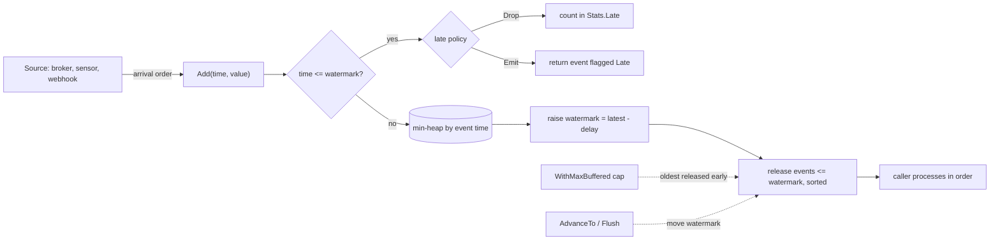
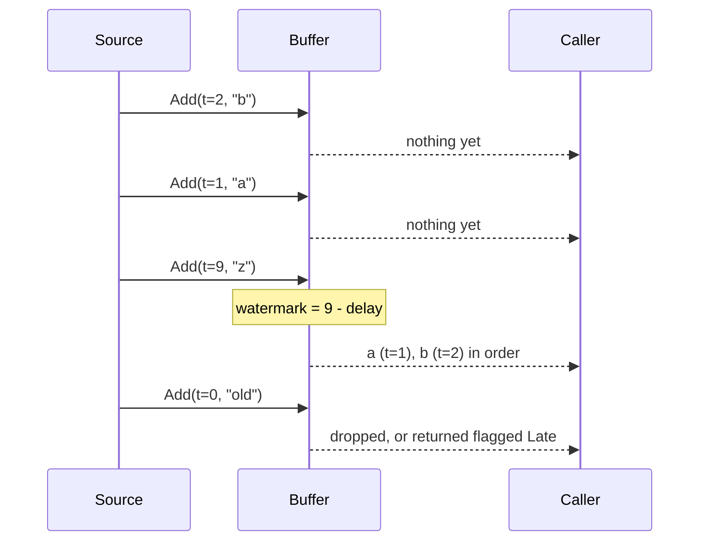

<h1 align="center">event-order</h1>

<p align="center">
Put out-of-order events back in event-time order, in plain Go.<br>
Generic, zero dependencies, one small idea: hold events until a watermark says nothing earlier is coming, then release them sorted.
</p>

<p align="center">
<a href="#try-it">Try it</a> |
<a href="#at-a-glance">At a glance</a> |
<a href="#how-it-works">How it works</a> |
<a href="#run-it-locally">Run locally</a> |
<a href="#status-and-roadmap">Roadmap</a>
</p>

Last updated: 2026-10-22. Status: runs locally (L1); private repository, not yet published as a module version.

## Contents

- [About](#about)
- [Try it](#try-it)
- [At a glance](#at-a-glance)
- [Features](#features)
- [Why it exists](#why-it-exists)
- [How it works](#how-it-works)
- [Engineering quality](#engineering-quality)
- [Run it locally](#run-it-locally)
- [Environment variables](#environment-variables)
- [Deployment](#deployment)
- [Status and roadmap](#status-and-roadmap)
- [Credits](#credits)

## About

Sensors, message brokers and mobile clients deliver events late and shuffled. A service that only needs "give me these
readings in the order they happened" should not need a stream processor. `event-order` is that one piece as a library:
you add events as they arrive, and it hands back the ones that are now safe to process, sorted by event time.

It is for backend engineers who consume MQTT, Kafka, webhook or queue traffic where the arrival order is not the event
order, and who want bounded memory and a clear answer for events that come too late.

## Try it

Not a hosted service: it is a library. The shortest way to see it work is the sensor example in this repo.

1. Clone the repository and run `go run ./examples/sensors`.
2. Read `examples/sensors/main.go`: six readings arrive out of order, and the last one is too late.
3. Change `WithMaxDelay(3*time.Second)` to `WithMaxDelay(10*time.Second)` and run again: the late reading is now in order.

Output of step 1 (run 2026-10-22):

```
t+1s  21.3C
t+2s  21.4C
t+3s  21.5C
t+4s  21.7C
t+2s  21.4C (retry)  <- late
t+9s  22.1C  (flushed)
{Buffered:0 Released:5 Late:1 Watermark:2026-01-01 12:00:09 +0000 UTC}
```

## At a glance

- Use `Buffer[T]` for one stream: `Add` returns what is ready, `AdvanceTo` moves the watermark from a timer or heartbeat, `Flush` empties it at shutdown.
- Use `Keyed[K, T]` for many streams (devices, users, partitions) that must be ordered independently, so one slow key never holds back the others.
- Use `Reorder(seq, opts...)` to wrap an `iter.Seq` of events and range over it in order.
- Use `WithMaxDelay` to say how far out of order events may arrive, `WithMaxBuffered` to cap memory, and `WithLatePolicy` to drop late events (counted) or emit them flagged.

```go
b := eventorder.New[Reading](
    eventorder.WithMaxDelay(5*time.Second),
    eventorder.WithMaxBuffered(10_000),
)
for msg := range incoming {
    for _, ev := range b.Add(msg.Time, msg.Reading) {
        process(ev.Value) // arrives sorted by event time
    }
}
for _, ev := range b.Flush() { // end of input
    process(ev.Value)
}
```

Install: `go get github.com/A-RYAN-1/event-order` (Go 1.23 or newer, for generics and `iter`; works once the repository is public). The import path ends in `event-order`; the package name is `eventorder` (Go package names cannot contain a dash).

## Features

- **Event-time ordering.** Events are released sorted by the time they happened, not the time they arrived. Equal times keep their arrival order.
- **Bounded delay.** The watermark is the largest event time seen minus the delay you choose; everything at or before it is released.
- **Late-event policy.** `Drop` discards and counts; `Emit` returns the late event at once with `Late` set, so you decide.
- **Bounded memory.** `WithMaxBuffered` releases the oldest events early instead of growing, at the price of more late arrivals.
- **Per-key buffers.** `Keyed` isolates devices or users; `Flush(key)` forgets a finished key.
- **No allocations on the hot path.** A typed heap and `AddTo(dst, ...)` reuse your slice.
- **Late-event hook.** `OnLate` sees every late event, dropped or not, for a dead-letter queue or a metric.
- **Quiet sources.** `AdvanceTo` moves the watermark without an event and never moves it backwards.
- **Iterator form.** `Reorder` turns a Go 1.23 `iter.Seq` into an ordered one, and stops reading when you stop ranging.

## Benchmarks

Against the loop most services write first (append, sort the whole slice, release the prefix), same input, `go test -bench .` on a Windows laptop, Go 1.27, 16 threads, shuffled in a window of 16 and of 256 events:

| Case | event-order | sort every Add | Allocations per Add |
|---|---|---|---|
| Disorder window 16 | 117 ns | 250 ns | 0 vs 3 |
| Disorder window 256 | 131 ns | 1303 ns | 0 vs 3 |

The sort-every-time cost grows with the window; the heap's grows with its logarithm, so the gap widens as disorder grows. `AddTo` appends into a slice you reuse, so the steady state allocates nothing. Reproduce with `go test -run xxx -bench . -benchmem`; the code is in `bench_test.go`. A fuzz test (`go test -fuzz FuzzBuffer`) checks that output is sorted and no event is lost or invented.

## Why it exists

Stream processors such as Flink document watermarks and allowed lateness well, but a Go service that only needs ordering
has no small, maintained library for it. A search of pkg.go.dev and GitHub on 2026-10-22 found a 4-star resequencer that
orders by sequence number (last pushed 2022, no license) and unrelated image-watermark packages, but no standalone
event-time reorder library. The idea comes from a real failure class: code that trusts arrival order when the data carries
its own clock.

## How it works





**Core rules**

| Rule | Behaviour |
|---|---|
| Watermark | largest event time seen, minus `MaxDelay`, minus one nanosecond (inclusive bound, as in Flink's bounded out-of-orderness) |
| Release | every held event with time at or before the watermark, in event-time order |
| Late | an event whose time is at or before the watermark when it arrives |
| Ties | equal times are released in arrival order (a sequence number breaks the tie) |
| Cap | when more than `MaxBuffered` events are held, the oldest are released and the watermark moves up to them |

**Tech stack**

| Part | Choice |
|---|---|
| Language | Go 1.23+, generics, `iter` |
| Ordering | `container/heap` min-heap on (event time, arrival sequence) |
| Dependencies | none (standard library only) |
| CI | GitHub Actions: vet, gofmt, race-enabled tests on Go 1.23 and stable |

**Design decisions**

1. **Event-time watermark, not a timer.** Release is driven by the data's own clock, so replaying yesterday's file gives the same result as live traffic. Trade-off: a source that goes quiet holds its last events until `AdvanceTo` or `Flush`.
2. **A heap, not a sorted slice.** Insertion and release are O(log n) per event. Trade-off: more allocations than an append-only slice (2 per `Add`, measured).
3. **Late events are reported, never silently reordered into the past.** Trade-off: the caller chooses `Drop` or `Emit`; the library will not guess.
4. **Not goroutine safe.** Locking would hide the real design question (who owns the buffer). Trade-off: callers add a mutex or a single goroutine themselves.
5. **No idle timeout built in.** A timer inside the library would need a clock and goroutines. Trade-off: the caller calls `AdvanceTo` from their own timer.

<details>
<summary>Project structure</summary>

```
buffer.go        Buffer, options, Stats, heap
keyed.go         Keyed: one Buffer per key
reorder.go       Reorder over iter.Seq
*_test.go        unit, property-style shuffle test, benchmark, runnable Example
examples/sensors runnable sample used in this README
.github/workflows/ci.yml
```

</details>

## Engineering quality

| Check | Result (2026-10-22) |
|---|---|
| Unit tests | pass: ordering, ties, lateness (drop and emit), memory cap, watermark never backwards, keyed, iterator |
| Shuffle test | 5,000 events shuffled inside a 30 s window come out fully sorted with 0 late |
| Coverage | 95.7 percent of statements |
| Speed | `Add` about 415 ns and 2 allocations per event (1 s delay, 1,024 cap; Windows laptop, 16 threads, Go 1.27) |
| Race detector and CI | green on GitHub Actions 2026-10-22 (vet, gofmt, `-race` tests on Go 1.23 and stable); the race detector cannot run on the author's laptop (no cgo) |
| Vet and gofmt | clean |

```
go vet ./...
go test -race -count=1 -cover ./...
go test -run xxx -bench .
```

## Run it locally

Works in Git Bash on Windows and on Linux. Needs Go 1.23 or newer.

```
git clone git@github.com:A-RYAN-1/event-order.git
cd event-order
go test -count=1 ./...
go run ./examples/sensors
```

Ready check: `go test` prints `ok github.com/A-RYAN-1/event-order`, and the example prints six lines and a stats line.

## Environment variables

None. The library reads no environment variables and makes no network calls.

## Deployment

Not deployed yet, and nothing to deploy: it is a library. It will be published as a tagged Go module
(`v0.1.0`), which `go get` downloads through the Go module proxy and which pkg.go.dev indexes on first request. The
repository is private until the author makes it public; until then the module cannot be fetched by others.
Free-tier limits: none apply.

## Status and roadmap

Rung L1 (builds and passes tests locally), checked 2026-10-22.

**Known limitations**

- Not safe for concurrent use.
- No built-in idle timeout; call `AdvanceTo` yourself.
- Not published: no tag, no pkg.go.dev page.

**Planned**

- [ ] Make the repository public (the author's decision), tag `v0.1.0`
- [ ] Timer-driven `AdvanceTo` helper and metrics hooks
- [ ] Benchmarks against a naive sort-then-release baseline, published here

## Credits

Designed and written by Aryan Deshmukh (A-RYAN-1). No co-authors.
